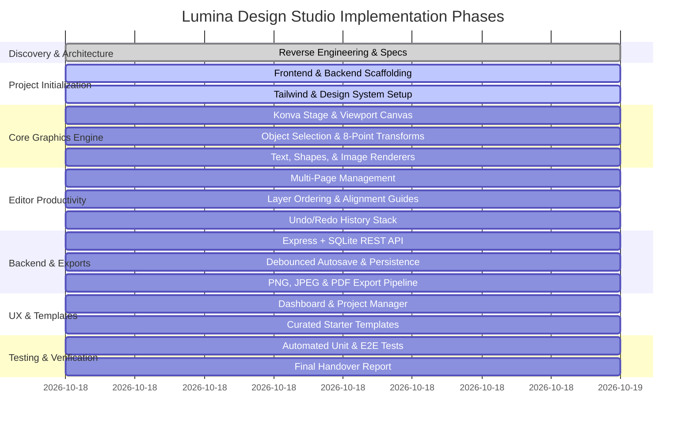

# Implementation Roadmap & Milestone Plan

This document defines the sequential implementation strategy for **Lumina Design Studio**.

---

## Roadmap Overview

---

## Detailed Milestones & Action Items

### Milestone 1: Environment & Project Scaffolding
- [x] Analyze Canva reference product and technical architecture.
- [x] Document reverse engineering report, feature matrix, and architecture.
- [ ] Initialize Vite + React 19 + TypeScript frontend with Tailwind CSS and Lucide icons.
- [ ] Initialize Express + SQLite backend with robust TypeScript configuration and file storage.
- [ ] Configure concurrently / dev scripts for single-command start.

### Milestone 2: Document Model & Central State Store
- [ ] Define comprehensive TypeScript types: `DesignDocument`, `Page`, `CanvasObject`, `TextObject`, `ShapeObject`, `ImageObject`, `SvgIconObject`.
- [ ] Implement Zustand `useEditorStore` with immutable updates.
- [ ] Implement undo/redo transaction stack with max 30 snapshots.
- [ ] Implement presets registry (Instagram Post, Story, YouTube Thumbnail, Presentation, Flyer, Custom).

### Milestone 3: Interactive Canvas & Graphics Engine
- [ ] Mount `<Stage>` with responsive scaling to fit browser viewport with margins.
- [ ] Implement pan and zoom controls (10% to 500% with zoom slider and fit-to-screen).
- [ ] Implement Konva `<Transformer>` with 8 custom resize handles and rotation pin.
- [ ] Implement click-outside deselect and multi-selection bounding box.
- [ ] Add dynamic alignment snapping lines (horizontal/vertical canvas centers and sibling boundaries).

### Milestone 4: Design Elements Subsystems
- [ ] **Text:** Headings, subheadings, body copy. Inline text editing, font family picker, font size, bold, italic, underline, alignment, color, letter-spacing, line-height.
- [ ] **Shapes:** Rectangle (with corner radius), circle, triangle, star, line. Custom fill, stroke color, stroke width, opacity, drop shadow.
- [ ] **Images:** File upload dropzone, thumbnail preview, canvas placement, scaling, aspect ratio preservation, flipping, opacity.
- [ ] **Icons/Graphics:** Curated vector icon collection with customizable fill color.
- [ ] **Backgrounds:** Solid palette, gradients, and custom color picker.

### Milestone 5: Editor Workstation UI & Productivity
- [ ] Build Top Navigation Bar: Back button, editable project title, save status badge, undo/redo buttons, export trigger.
- [ ] Build Left Sidebar: Tabs for Templates, Elements, Text, Uploads, Background, Pages with smooth slide-out drawers.
- [ ] Build Contextual Inspector: Dynamic toolbar displaying only relevant tools for the selected object.
- [ ] Build Bottom Bar: Multi-page thumbnail navigator, page counter, zoom controls.

### Milestone 6: Multi-Page & Layer Stacking
- [ ] Implement Add Page, Duplicate Page, Delete Page (safeguard minimum 1 page).
- [ ] Implement Layer ordering: Bring to Front, Send to Back, Bring Forward, Send Backward.
- [ ] Implement Keyboard shortcuts: `Ctrl+Z` (Undo), `Ctrl+Y` (Redo), `Ctrl+C` (Copy), `Ctrl+V` (Paste), `Ctrl+D` (Duplicate), `Delete` (Remove), Arrow keys (1px/10px nudge).

### Milestone 7: Persistence, Autosave & Backend REST API
- [ ] Build Express server with SQLite database: `/api/designs` (GET list, POST create, GET :id, PUT :id, DELETE :id).
- [ ] Implement debounced autosave hook (1000ms) with visual indicator ("Saving...", "Saved", "Error").
- [ ] Implement localStorage / IndexedDB offline fallback so work is never lost even if the backend is restarting.
- [ ] Implement file upload endpoint `/api/uploads` with multer, MIME checking, and size limits.

### Milestone 8: Real File Export Pipeline
- [ ] High-DPI offscreen rendering for PNG export with optional transparent background.
- [ ] JPEG export with compression quality slider.
- [ ] PDF export using `jspdf` for multi-page documents.
- [ ] Automated download trigger with sanitized project titles (e.g. `summer-sale-instagram-post.png`).

### Milestone 9: Curated Starter Templates Library
- [ ] Social Media Posts (Instagram 1080x1080): Modern Sale, Motivational Quote, Product Showcase.
- [ ] YouTube Thumbnails (1280x720): Tech Review, Gaming, Podcast.
- [ ] Marketing & Print (Flyers/Banners): Event Flyer, Business Card, Announcement.
- [ ] One-click application of templates to current page or as new page.

### Milestone 10: Dashboard & Project Management
- [ ] Modern dashboard header with search and "Create a design" button.
- [ ] Quick-start dimension preset cards.
- [ ] Recent projects grid with live thumbnail previews, edit title, duplicate, and delete actions.
- [ ] Template discovery browser with category filters.

### Milestone 11: Testing, Verification & Handover
- [ ] Automated unit tests for document model transformations and undo/redo stack.
- [ ] API integration tests for CRUD and upload endpoints.
- [ ] End-to-end browser testing of editor interaction, object manipulation, and export.
- [ ] Final handover report with operational instructions and environment configuration.
