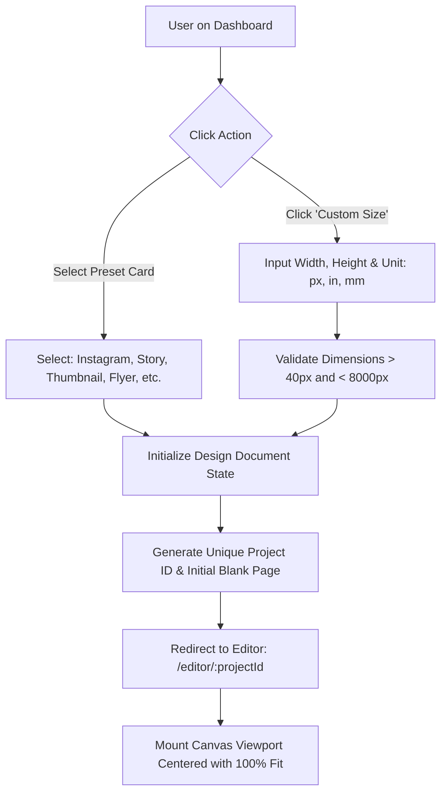
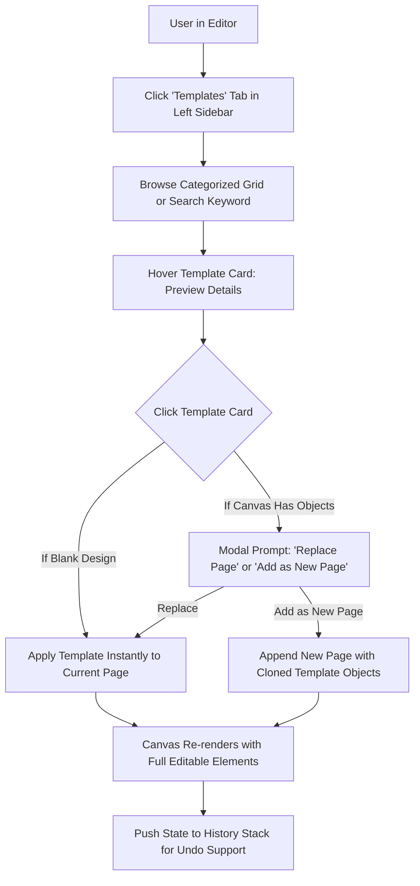
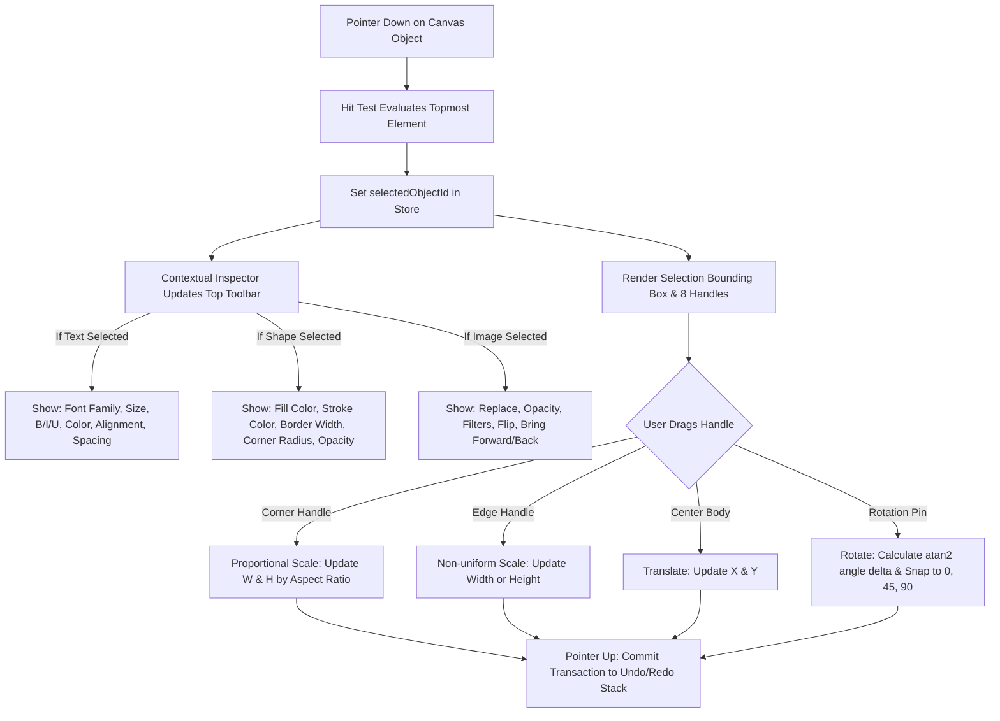
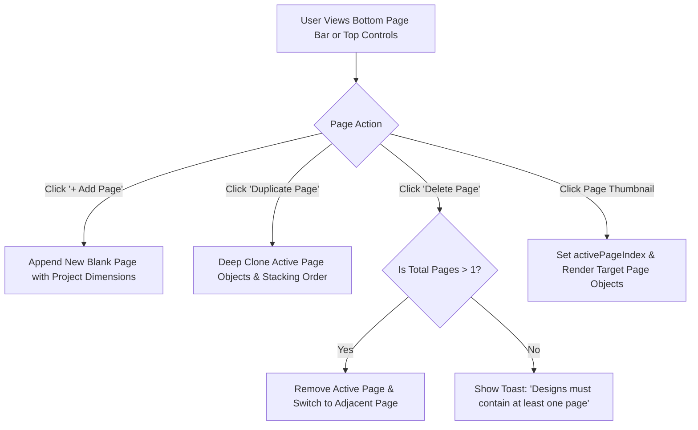
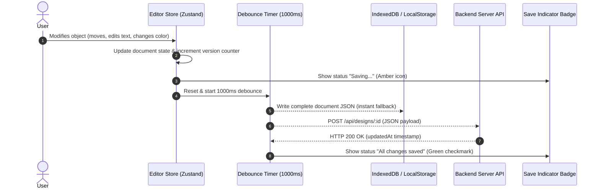

# User Flows & Interaction Specifications

This document maps the primary user journeys and interaction states within **Lumina Design Studio**.

---

## 1. Flow: Create New Design (Presets vs Custom)



### Steps:
1. User arrives on Dashboard (`/`).
2. User clicks a preset button (e.g., "Instagram Post 1080x1080") or clicks "Custom Size".
3. If custom, user inputs width and height (e.g., `1200` x `630` px).
4. System validates dimensions, creates a new document model with 1 default blank page, and persists it to local storage / DB.
5. Router navigates to `/editor/:id`.
6. Canvas automatically calculates initial zoom scale to fit comfortably inside the viewport with margins.

---

## 2. Flow: Template Discovery & Selection



### Steps:
1. From the left sidebar, user clicks "Templates".
2. System loads categorized templates (Social, Marketing, Cards, Thumbnails).
3. Clicking a template clones the structured JSON objects into the page model.
4. All text nodes, shapes, and images from the template become fully editable immediately.

---

## 3. Flow: Direct Object Manipulation & Contextual Toolbars



---

## 4. Flow: Multi-Page Management



---

## 5. Flow: Autosave & Persistence Lifecycle



---

## 6. Flow: Real File Export (PNG, JPEG, PDF)

```mermaid
graph TD
    A[User clicks 'Export' Button] --> B[Open Export Modal Dialog]
    B --> C[Select Format: PNG, JPEG, or PDF]
    C --> D[Select Resolution Scale: 1x, 2x (High-DPI Retina)]
    D --> E{Format Specific Settings}
    E -->|PNG| F[Toggle 'Transparent Background']
    E -->|JPEG| G[Adjust Quality Slider: 70% - 100%]
    E -->|PDF| H[Select Pages: All Pages or Current Page]
    F --> I[Click 'Download' Button]
    G --> I
    H --> I
    I --> J[Render Target Canvas at Exact Scaled Dimensions Offscreen]
    J --> K[Generate Blob using canvas.toBlob or jsPDF]
    K --> L[Create Object URL & Trigger Programmatic Download Link]
    L --> M[File Saved to User's Download Folder with Sanitize Title]
```
